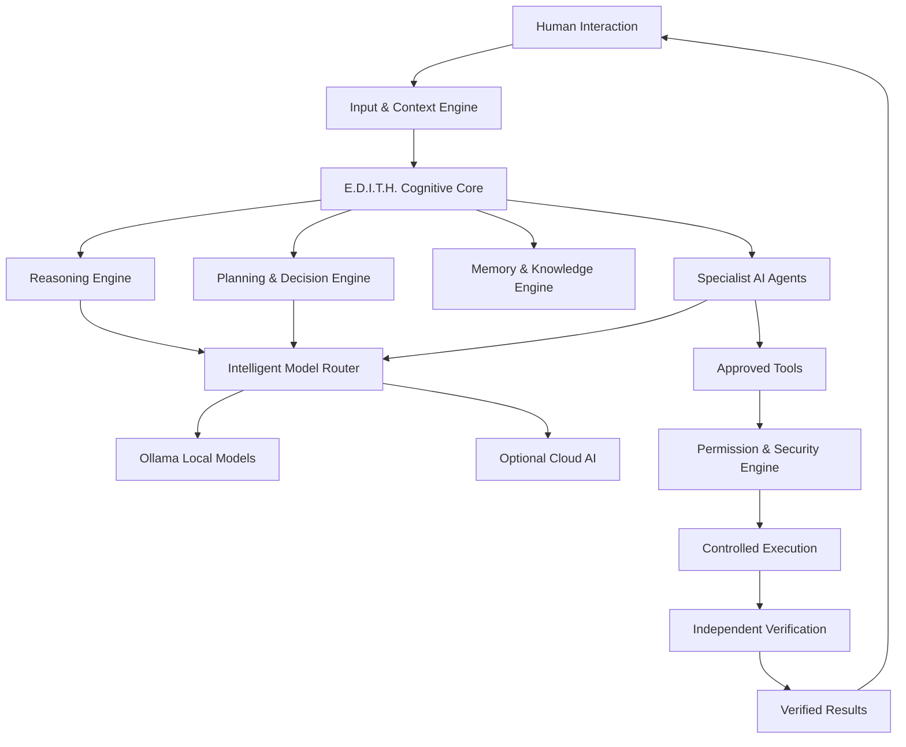
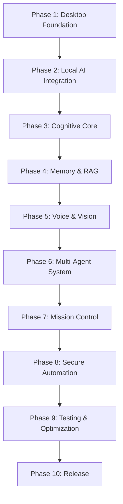

# E.D.I.T.H.-THE-FUTHER-AI
E.D.I.T.H. – The Future of AI is an advanced multimodal cognitive assistant combining neural-inspired intelligence, multiple AI models, human-like interaction, voice, vision, persistent memory, autonomous agents, real-time learning, intelligent automation and secure decision-making to transform how humans interact with technology.


 <div align="center">

# E.D.I.T.H.
### The Future of AI

**Perceive • Reason • Plan • Act • Learn**


### Your Intelligent Digital Companion

An advanced multimodal cognitive AI assistant combining neural-inspired intelligence, multiple AI models, natural voice interaction, computer vision, persistent memory, autonomous agents, intelligent automation and secure decision-making.

[](https://python.org)
[](https://doc.qt.io/qtforpython/)
[](https://ollama.com)
[](#features)
[](#roadmap)

</div>

---

## 🌌 About E.D.I.T.H.

E.D.I.T.H. (Enhanced Digital Intelligence & Thinking Hub) is a next-generation AI assistant designed to bring multiple intelligence capabilities into one unified desktop environment.

It combines local AI models, optional cloud intelligence, cognitive workflows, specialist agents, multimodal perception, knowledge retrieval and permission-controlled automation.

**The vision:** An AI assistant that can understand, analyze, plan, research, create, learn from approved feedback and help execute complex tasks while keeping humans in control.

> E.D.I.T.H. is human-inspired software, not a conscious or sentient being.

## ✨ Features

| Intelligence | Capabilities |
|---|---|
| 🧠 Cognitive Core | Reasoning, critical thinking, planning and decision support |
| 🤖 Multi-Model Brain | Ollama models and optional cloud AI |
| 👁️ Vision Intelligence | Image, screenshot, document and visual analysis |
| 🎙️ Voice Intelligence | Speech recognition, natural TTS and multilingual communication |
| 🧬 Memory System | Working, episodic, semantic and approved persistent memory |
| 🔬 Research Intelligence | Knowledge retrieval, source analysis and evidence checking |
| ⚡ Autonomous Agents | Specialist task delegation and orchestration |
| 💻 Developer Intelligence | Coding, debugging, architecture and testing |
| 🛡️ Cybersecurity | Authorized security analysis and defensive intelligence |
| 🌐 Mission Control | Goal planning, task tracking and progress monitoring |
| 🔄 Learning Engine | Feedback-based improvement and knowledge refinement |
| 🔐 Security Layer | Permissions, sandboxing, audit logs and privacy controls |

## 🧠 Cognitive Architecture



## 🔁 How E.D.I.T.H. Thinks


## 🤖 Specialist Agent Network

E.D.I.T.H. is designed around 30 specialized agents:

1. Chief Cognitive Agent
2. Reasoning Agent
3. Critical Thinking Agent
4. Decision Intelligence Agent
5. Planning Agent
6. Meta-Reasoning Agent
7. Memory Agent
8. Research Agent
9. Knowledge Graph Agent
10. Learning Agent
11. Curiosity Agent
12. Scientific Analysis Agent
13. Vision Agent
14. Image Analysis Agent
15. Video Intelligence Agent
16. Speech Recognition Agent
17. Voice Generation Agent
18. Document Intelligence Agent
19. Coding Agent
20. Debugging Agent
21. Software Architecture Agent
22. Cybersecurity Agent
23. Digital Forensics Agent
24. System Administration Agent
25. Desktop Automation Agent
26. Browser Agent
27. File Management Agent
28. Mission Control Agent
29. Monitoring & Recovery Agent
30. Independent Verification Agent

Every agent should have defined responsibilities, scoped permissions, validated outputs and traceable execution logs.

## 🎙️ Voice & Multimodal Intelligence

- Natural female voice options.
- Real-time speech recognition.
- Streaming text-to-speech.
- Voice interruption and conversation turn-taking.
- Multilingual communication.
- Image and screenshot understanding.
- Video frame analysis.
- OCR and document understanding.
- Audio analysis and transcription.
- Multimodal evidence fusion.

## 🧬 Advanced Memory System

- Working memory.
- Episodic memory.
- Semantic memory.
- Procedural memory.
- Project memory.
- Goal and task memory.
- Knowledge graph.
- Vector-based retrieval.
- Source attribution.
- Memory conflict detection.
- User-approved persistent memory.
- Memory inspection, correction and deletion.

## ⚙️ Technology Stack

| Layer | Technologies |
|---|---|
| Programming | Python, C++, JavaScript, TypeScript |
| Desktop UI | PySide6, Qt Quick, QML |
| Local AI | Ollama |
| Models | Qwen, Llama, Gemma |
| AI Frameworks | PyTorch, Transformers |
| Agent Orchestration | LangGraph, asyncio |
| Speech Recognition | Whisper, faster-whisper |
| Voice Generation | Piper, Kokoro |
| Computer Vision | OpenCV, Pillow |
| OCR | Tesseract, PaddleOCR |
| Vector Search | FAISS, Qdrant |
| Database | SQLite, PostgreSQL |
| Knowledge Graph | NetworkX, Neo4j |
| Backend | FastAPI, WebSockets |
| Automation | Playwright |
| Monitoring | psutil, OpenTelemetry |
| Security | cryptography, keyring |
| Testing | pytest, Hypothesis |
| Packaging | PyInstaller, Nuitka |

## 🏗️ Project Structure

```text
EDITH/
│
├── main.py
├── launcher.py
├── requirements.txt
│
├── config/
│   ├── settings.yaml
│   ├── models.yaml
│   ├── agents.yaml
│   └── permissions.yaml
│
├── core/
│   ├── cognitive_engine.py
│   ├── orchestrator.py
│   ├── reasoning_engine.py
│   ├── planning_engine.py
│   ├── decision_engine.py
│   └── verification_engine.py
│
├── agents/
│   ├── research/
│   ├── memory/
│   ├── vision/
│   ├── speech/
│   ├── coding/
│   ├── security/
│   └── automation/
│
├── models/
│   ├── model_router.py
│   ├── ollama_provider.py
│   └── cloud_provider.py
│
├── memory/
│   ├── working_memory.py
│   ├── episodic_memory.py
│   ├── semantic_memory.py
│   └── vector_store.py
│
├── perception/
│   ├── vision.py
│   ├── audio.py
│   ├── ocr.py
│   └── video.py
│
├── voice/
│   ├── speech_to_text.py
│   └── text_to_speech.py
│
├── mission_control/
│   ├── planner.py
│   ├── scheduler.py
│   └── monitor.py
│
├── automation/
│   ├── browser.py
│   ├── desktop.py
│   └── approval.py
│
├── security/
│   ├── policy_engine.py
│   ├── sandbox.py
│   └── audit.py
│
├── interface/
│   ├── main_window.py
│   ├── holographic_hud.qml
│   └── mission_dashboard.py
│
├── database/
├── tests/
├── docs/
└── assets/
    └── edith-hero.png
```

## 🚀 Installation

### Requirements

- Python 3.11+
- Git
- Ollama
- Compatible local AI model
- Optional microphone, camera and speakers

### 1. Clone the repository

```bash
git clone https://github.com/YOUR-USERNAME/EDITH.git
cd EDITH
```

### 2. Create a virtual environment

**Windows**

```powershell
py -3.11 -m venv .venv
.venv\Scripts\Activate.ps1
```

**Ubuntu / Linux**

```bash
python3 -m venv .venv
source .venv/bin/activate
```

### 3. Install dependencies

```bash
python -m pip install --upgrade pip
pip install -r requirements.txt
```

### 4. Configure Ollama

Install Ollama from https://ollama.com.

```bash
ollama pull qwen2.5:3b
ollama run qwen2.5:3b
```

### 5. Launch E.D.I.T.H.

```bash
python launcher.py
```

If your entry point is `main.py`, use:

```bash
python main.py
```

## 🔐 Security & Privacy

E.D.I.T.H. follows a human-controlled automation model:

- Local-first processing where practical.
- Explicit microphone, camera and screen permissions.
- Approval before sending, deleting, purchasing or modifying important data.
- Least-privilege agent permissions.
- Sandboxed code execution.
- Secure API-key storage.
- Encrypted persistent memory.
- Audit logs for tool execution.
- Verification before reporting completed actions.
- User control over stored memories.

Only conduct cybersecurity assessments on systems you own or are authorized to test.

## 📊 Development Roadmap



| Phase | Development milestone |
|---|---|
| 1 | Desktop UI and application foundation |
| 2 | Local model integration |
| 3 | Reasoning and planning engines |
| 4 | Memory and knowledge retrieval |
| 5 | Voice, vision and multimodal support |
| 6 | Specialist agent orchestration |
| 7 | Mission control and task management |
| 8 | Permission-controlled automation |
| 9 | Security, performance and reliability testing |
| 10 | Packaging and release |

## 📈 Performance & Quality Metrics

Measure actual system performance:

- Model response latency.
- Tokens generated per second.
- Memory and CPU consumption.
- Retrieval relevance.
- Agent task success rate.
- Verification accuracy.
- Voice recognition quality.
- Automation success and recovery rate.
- Test coverage.
- Security findings.

## 💻 Hardware Recommendations

For a laptop with 16 GB RAM and integrated graphics:

- Start with a small quantized local model.
- Run one primary model at a time.
- Keep vision and audio modules optional.
- Monitor CPU and RAM usage.
- Use cloud models only when explicitly configured.

## 🤝 Contributing

1. Fork the repository.
2. Create a feature branch.
3. Implement and test your changes.
4. Update documentation.
5. Submit a pull request.

## 📌 Project Status

**E.D.I.T.H. is an ambitious project architecture under development.**

Features described in this README are intended capabilities and design goals. Mark individual modules as implemented only after they have working code and passing tests.

## 📜 License

A license will be selected before public distribution.

---

<div align="center">

### PERCEIVE. REASON. PLAN. ACT. LEARN.

**E.D.I.T.H. — The Future of AI**

*More than an AI assistant. A smarter way to work.*

</div>
